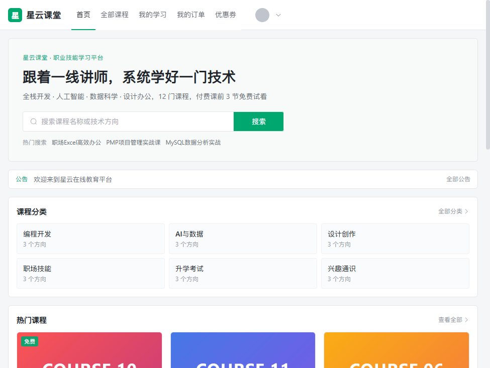
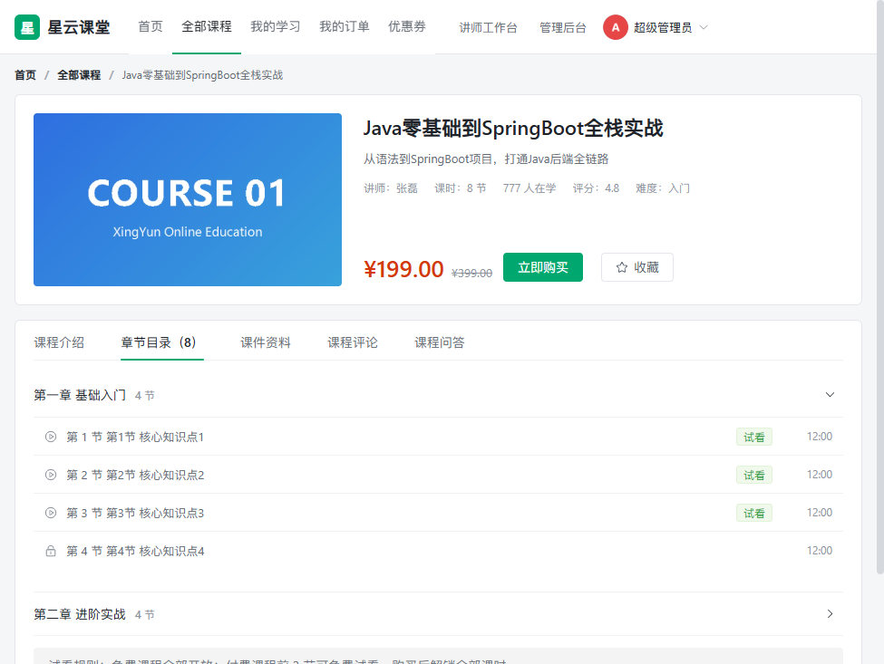
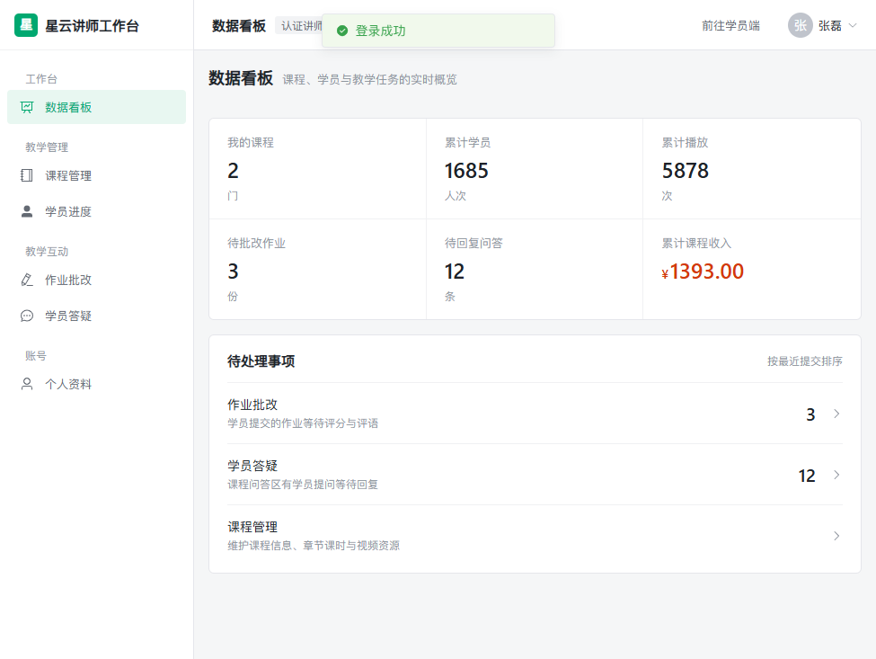
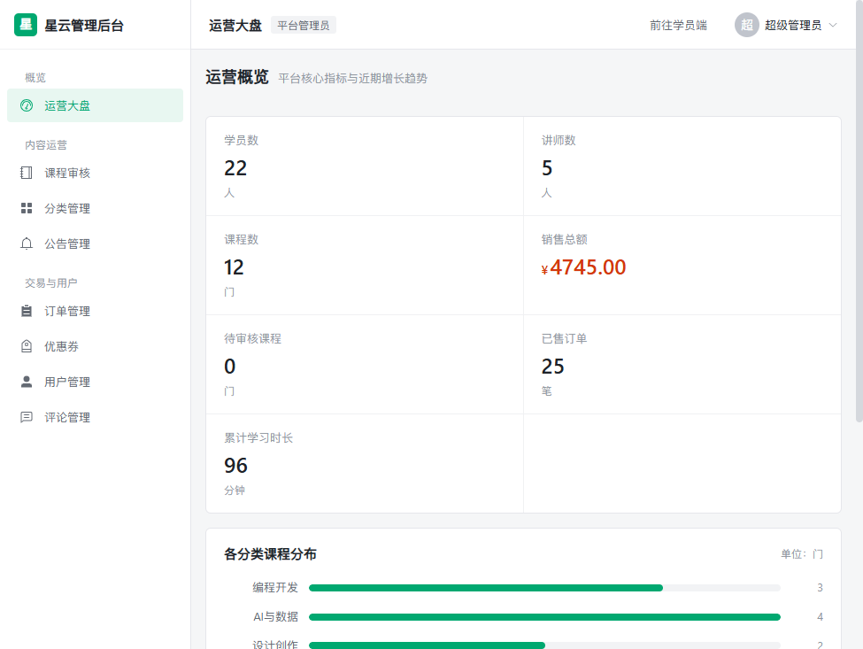

# XingYun 星云课堂 · 在线教育平台

Vue3 + Spring Boot 前后端分离的在线教育平台，一个工程实现学员端、讲师端与管理后台，覆盖课程浏览、试看购买、视频学习、随堂测验、作业批改到结业发证的完整学习闭环。

`JDK 17` · `Spring Boot 2.7.18` · `MyBatis-Plus 3.5.5` · `MySQL 8.0` · `Redis` · `Vue 3.4` · `Vite 5.3` · `Element Plus 2.7` · `Pinia` · `Axios`

## 项目预览


| 学员端首页                                     | 课程详情                                      |
| ---------------------------------------------- | --------------------------------------------- |
|  |  |


| 讲师数据看板                                          | 管理后台运营大盘                                        |
| ----------------------------------------------------- | ------------------------------------------------------- |
|  |  |

## 快速启动

前置：JDK 17、Maven 3.8+、Node.js 18+、MySQL 8.0、Redis 5.0+。

```powershell
# 1. 启动 MySQL 与 Redis，并导入数据库脚本
mysql -uroot -p < sql/01_xingyun_schema.sql
mysql -uroot -p < sql/02_xingyun_data.sql
mysql -uroot -p < sql/03_xingyun_optimize.sql

# 2. 打包并启动后端（端口 8080）
cd xingyun-server
mvn package "-Dmaven.test.skip=true"
java -jar target\xingyun-server.jar
或者  mvn spring-boot:run

# 3. 启动前端（端口 5173）
cd ..\xingyun-ui
npm install
npm run dev
```

浏览器访问 `http://localhost:5173`；后端健康检查 `http://localhost:8080/api/actuator/health` 应返回 `{"status":"UP"}`。首次运行可执行 `xingyun-server/gen_placeholders.ps1` 生成封面与头像占位图。

演示账号与权限说明见 [docs/项目说明文档.md](docs/项目说明文档.md) 第二章。

## 文档

- [项目说明文档](docs/项目说明文档.md)：项目唯一完整文档，包含账号权限、功能说明、架构、数据库、接口、部署、测试与安全设计。

## 目录结构

```text
XingYun/
├─ sql/                 建表脚本、演示数据与索引增量
├─ xingyun-server/      Spring Boot 后端（com.xingyun 标准分层）
│  ├─ upload/           本地上传：video / cover / ware / avatar
│  └─ test-api.ps1      接口自动化回归脚本
├─ xingyun-ui/          Vue3 前端（学员端 / 讲师端 / 管理后台）
├─ docs/                项目说明文档与界面截图
└─ README.md
```

## License 与声明

本项目用于学习、教学与技术交流，未声明开源许可证，默认保留所有权利。内置演示数据与截图仅用于功能展示，请勿直接用于商业生产环境。
