# 星云课堂 XingYun · 在线教育平台完整文档

> 文档版本：v1.3（整合版）　|　最后更新：2026-10-25　|　适用代码版本：v1.3
>
> 本文档是项目的唯一完整文档，整合了项目介绍、账号权限、功能说明、功能演示、技术架构、数据库设计、接口说明、使用指南、测试、安全、版本演进与开发要点。内容面向项目评审、技术面试、开源发布与技术社区分享。截图均来自本地实际运行环境，路径相对于 `docs/`。

---

## 目录

- [一、项目介绍](#一项目介绍)
- [二、账号与权限](#二账号与权限)
- [三、功能说明](#三功能说明)
- [四、功能演示](#四功能演示)
- [五、技术架构](#五技术架构)
- [六、数据库设计](#六数据库设计)
- [七、接口说明](#七接口说明)
- [八、使用指南](#八使用指南)
- [九、测试与质量保障](#九测试与质量保障)
- [十、安全设计](#十安全设计)
- [十一、版本演进](#十一版本演进)
- [十二、开发要点](#十二开发要点)
- [十三、文档与发布说明](#十三文档与发布说明)
- [十四、附录：目录结构](#十四附录目录结构)

---

## 一、项目介绍

### 1.1 项目定位

星云课堂是一个面向职业技能培训场景的在线教育平台，采用**前后端分离的单体架构**，在一个 Vue 工程内实现**学员端、讲师端、管理后台**三套布局与权限体系。业务覆盖课程浏览、购买支付、在线学习、随堂测验、作业批改到结业发证的完整学习闭环，同时提供平台侧的课程审核、用户治理与运营数据看板。

项目按**可运行、可回归、可部署**的标准组织：后端具备统一异常处理、接口级与数据级双重权限校验、健康检查与优雅停机；前端具备统一设计系统、请求层容错与生产构建分包。

### 1.2 适用场景

| 场景           | 说明                                                                     |
| -------------- | ------------------------------------------------------------------------ |
| 全栈学习与教学 | 完整的 Spring Boot + Vue3 工程范例，分层清晰，适合作为课程设计或毕业设计 |
| 技术面试作品   | 覆盖鉴权、支付幂等、视频防盗链、并发控制等常见考点                       |
| 企业内部培训   | 可直接替换课程数据，作为轻量级企业学习平台原型                           |
| 二次开发基线   | 三端分离、模块边界明确，便于扩展直播、考试、消息通知等能力               |

### 1.3 核心能力

- **三端一体**：学员端、讲师端、管理后台共用一套 API 与组件库，按 `userType` 分流路由与菜单。
- **完整学习闭环**：课程详情 → 试看/购买 → 视频学习 → 进度上报 → 随堂测验 → 课程作业 → 结业证书。
- **内容运营**：两级课程分类、课程审核与上下架、首页推荐位、公告发布、评论治理、优惠券发放。
- **数据看板**：管理后台展示营收、订单、用户、课程分布与近 7 日新增学员；讲师端展示课程、学员、播放、收入与待办。
- **工程化底座**：配置外置化、统一返回结构、全局异常兜底、链路追踪、接口回归脚本、前端构建分包。

### 1.4 演示数据规模

内置演示数据可直接体验全部功能，无需手工造数：

| 资源                | 数量                                               |
| ------------------- | -------------------------------------------------- |
| 一级 / 二级课程分类 | 6 / 18                                             |
| 课程                | 12 门（每门 8 课时，第 4 节挂测验、第 8 节挂作业） |
| 讲师                | 5 位                                               |
| 学员                | 20 位                                              |
| 优惠券              | 3 张（满减 / 立减 / 折扣）                         |

演示数据由 `sql/02_xingyun_data.sql` 提供，可通过 `sql/gen_data.ps1` 确定性重新生成；封面、头像等占位资源由 `xingyun-server/gen_placeholders.ps1` 生成。

---

## 二、账号与权限

### 2.1 角色说明

系统按 `sys_user.user_type` 划分三类角色，并通过 `sys_role` / `sys_user_role` 维护角色编码（`STUDENT`、`TEACHER`、`ADMIN`）：

| 角色     | `user_type` | 前端入口       | 说明                                                     |
| -------- | ----------- | -------------- | -------------------------------------------------------- |
| 学员     | 1           | `/home`        | 浏览、购买、学习、测验、作业、评论问答与证书             |
| 讲师     | 2           | `/teacher/*`   | 管理本人课程与课时、批改作业、回复问答、查看学员进度     |
| 管理员   | 3           | `/admin/*`     | 课程审核、用户治理、分类/优惠券/公告管理与运营数据大盘   |

注册账号默认为学员身份，用户名 4–20 位、密码 6–20 位。

### 2.2 完整账号清单

| 角色     | 用户名                | 昵称           | 初始密码 | 登录后入口           |
| -------- | --------------------- | -------------- | -------- | -------------------- |
| 管理员   | `admin`               | 超级管理员     | `123456` | `/admin/dashboard`   |
| 讲师     | `teacher1`            | 张磊           | `123456` | `/teacher/dashboard` |
| 讲师     | `teacher2`            | 李婷           | `123456` | `/teacher/dashboard` |
| 讲师     | `teacher3`            | 王博           | `123456` | `/teacher/dashboard` |
| 讲师     | `teacher4`            | 赵琳           | `123456` | `/teacher/dashboard` |
| 讲师     | `teacher5`            | 陈浩           | `123456` | `/teacher/dashboard` |
| 学员     | `student01`           | 学员01号       | `123456` | `/home`              |
| 学员     | `student02`           | 学员02号       | `123456` | `/home`              |
| 学员     | `student03`           | 学员03号       | `123456` | `/home`              |
| 学员     | `student04`           | 学员04号       | `123456` | `/home`              |
| 学员     | `student05`           | 学员05号       | `123456` | `/home`              |
| 学员     | `student06`           | 学员06号       | `123456` | `/home`              |
| 学员     | `student07`           | 学员07号       | `123456` | `/home`              |
| 学员     | `student08`           | 学员08号       | `123456` | `/home`              |
| 学员     | `student09`           | 学员09号       | `123456` | `/home`              |
| 学员     | `student10`           | 学员10号       | `123456` | `/home`              |
| 学员     | `student11`           | 学员11号       | `123456` | `/home`              |
| 学员     | `student12`           | 学员12号       | `123456` | `/home`              |
| 学员     | `student13`           | 学员13号       | `123456` | `/home`              |
| 学员     | `student14`           | 学员14号       | `123456` | `/home`              |
| 学员     | `student15`           | 学员15号       | `123456` | `/home`              |
| 学员     | `student16`           | 学员16号       | `123456` | `/home`              |
| 学员     | `student17`           | 学员17号       | `123456` | `/home`              |
| 学员     | `student18`           | 学员18号       | `123456` | `/home`              |
| 学员     | `student19`           | 学员19号       | `123456` | `/home`              |
| 学员     | `student20`           | 学员20号       | `123456` | `/home`              |

> 数据库中密码以 BCrypt 密文存储，上表为内置演示密码。账号信息仅在本文档集中归档，登录页面不展示任何账号或密码提示；生产环境必须修改全部默认密码。

### 2.3 权限边界

| 范围         | 学员                                   | 讲师                                       | 管理员                             |
| ------------ | -------------------------------------- | ------------------------------------------ | ---------------------------------- |
| 前端页面     | 学员端全部页面                         | 讲师端全部页面                             | 管理后台全部页面                   |
| `/teacher/**` 管理类接口 | 不可用                      | 可用，且仅能操作本人课程、课时、作业与问答 | 可用                               |
| `/admin/**` 接口        | 不可用                      | 不可用                                     | 可用                               |
| 公开接口     | 可用（游客亦可）                       | 可用                                       | 可用                               |
| 登录态接口   | 可用                                   | 可用                                       | 可用                               |

鉴权分两层：`JwtInterceptor` 按 URL 前缀完成角色校验，Service 层再按数据归属做二次校验。讲师访问他人课程、课时、作业或问答时返回 403，避免仅靠前端隐藏菜单造成越权。

### 2.4 安全提示

- 密码以 BCrypt 加盐存储并设置为 `WRITE_ONLY`，任何接口都不返回密码。
- 管理员可禁用账号或重置密码，但**不能操作自己的账号**，避免误操作锁死。
- 账号被禁用后，Redis 中对应登录态立即删除，旧 Token 再次访问返回 401。
- 登录页不展示任何账号与密码提示，演示账号统一归档于本文档 2.2 节；**生产部署前必须修改全部默认密码**。

---

## 三、功能说明

### 3.1 学员端功能与操作路径

| 页面       | 路径               | 操作与规则                                                                                       |
| ---------- | ------------------ | ------------------------------------------------------------------------------------------------ |
| 首页       | `/home`            | 搜索、分类入口、热门课程、公告；公告可查看详情与全部列表                                         |
| 全部课程   | `/courses`         | 按分类 / 难度 / 免费筛选，关键词搜索，排序；分页浏览                                             |
| 课程详情   | `/course/:id`      | 查看介绍、章节目录、课件、评论、问答；领券下单、收藏课程                                         |
| 在线学习   | `/learn/:id`       | 签名播放、拖动、断点续播、定时上报；随堂测验、作业、课件在此完成                                 |
| 我的学习   | `/my`              | 全部 / 学习中 / 已学完筛选，点击卡片继续学习                                                     |
| 我的订单   | `/orders`          | 查看订单号、课程、金额、状态；待支付订单可继续支付                                               |
| 我的优惠券 | `/coupons`         | 领取优惠券，查看未用 / 已用 / 过期状态                                                           |
| 我的收藏   | `/favorites`       | 收藏与取消收藏课程                                                                               |
| 我的证书   | `/certificates`    | 查看证书编号、课程、讲师与发证时间                                                               |
| 错题本     | `/wrongbook`       | 展示题型、正确答案、解析与错误次数；重做答对后自动移出                                           |
| 个人资料   | `/profile`         | 修改昵称、头像、联系方式、简介与密码（新旧密码不可相同）                                         |

**试看与购买规则**

- 免费课程：全部课时可播放、可评论，进度计入「我的学习」。
- 付费课程：前 3 节可试看；购买后解锁全部课时；已购或免费才可评论评分。
- 未购买时上报付费课时进度会被拒绝，防止伪造学习记录领取证书。

### 3.2 讲师端功能与操作路径

| 页面     | 路径                     | 操作与规则                                                                       |
| -------- | ------------------------ | -------------------------------------------------------------------------------- |
| 数据看板 | `/teacher/dashboard`     | 我的课程数、总学员、总播放、待批作业、待答问题、总收入                           |
| 课程管理 | `/teacher/course`        | 新增 / 编辑课程（分类、价格、封面、难度、标签），提交审核、上下架、删除           |
| 课时管理 | `/teacher/lesson/:id`    | 维护章节与课时，上传或选择视频、课件，设置试看、排序与上下架                     |
| 学员进度 | `/teacher/student`       | 查看本人课程下学员的课时进度、学习分钟、最近学习时间与是否学完                   |
| 作业批改 | `/teacher/grade`         | 待批列表打分（0–100）并填写评语，可通过或打回重交                                |
| 学员答疑 | `/teacher/qa`            | 查看待答问题并回复，回复后学员在课程问答页可见                                   |
| 个人资料 | `/teacher/profile`       | 维护讲师头衔、简介与头像                                                         |

课程必须「审核通过 + 上架」后才会出现在学员端；保存课时后自动回写课程课时数与总时长。讲师仅能管理本人课程，统计口径也只覆盖本人数据。

### 3.3 管理后台功能与操作路径

| 页面         | 路径                     | 操作与规则                                                               |
| ------------ | ------------------------ | ------------------------------------------------------------------------ |
| 运营大盘     | `/admin/dashboard`       | 学员数、讲师数、课程数、待审核、订单数、营收、累计学习时长与趋势图       |
| 用户管理     | `/admin/user`            | 分页搜索、启用 / 禁用、重置密码；不能操作自己的账号                      |
| 课程审核     | `/admin/course`          | 查看全部课程状态，通过后自动上架；驳回必须填原因；可上下架、设推荐、删除 |
| 订单管理     | `/admin/order`           | 只读查看全量订单（单号 / 课程 / 用户 / 金额 / 状态 / 时间）              |
| 评论管理     | `/admin/comment`         | 查看全量评论，屏蔽 / 恢复 / 删除                                         |
| 分类管理     | `/admin/category`        | 两级分类增删改；分类下有子分类或课程时拒绝删除                           |
| 优惠券管理   | `/admin/coupon`          | 创建满减 / 立减 / 折扣券，设置总量（0 为不限）与有效天数                 |
| 公告管理     | `/admin/announcement`    | 发布、编辑、删除通知与活动公告，发布后学员首页可见                       |
| 个人资料     | `/admin/profile`         | 维护管理员个人资料与密码                                                 |

---

## 四、功能演示

本章按角色展示主要界面，截图均为真实运行界面（Windows 11 + Chrome）。

### 4.1 登录与角色分流

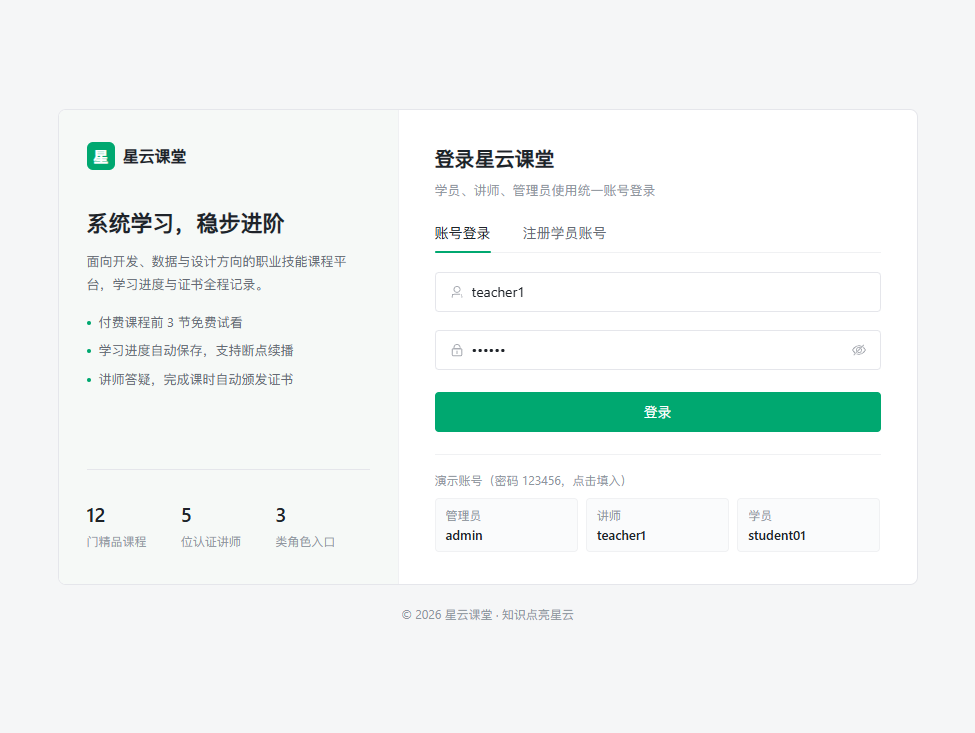

学员、讲师、管理员统一入口，登录后按 `userType` 自动进入对应首页。页面仅保留账号登录与注册两个页签，不展示任何演示账号或密码提示；登录态由 JWT + Redis 共同维护，支持禁用用户即时踢下线。

### 4.2 学员端

#### 4.2.1 首页


首页由「搜索 + 公告 + 分类 + 热门课程 + 平台能力」构成，信息密度优先、装饰元素克制。顶部导航固定 60px，内容区 1200px 居中。

#### 4.2.2 课程列表

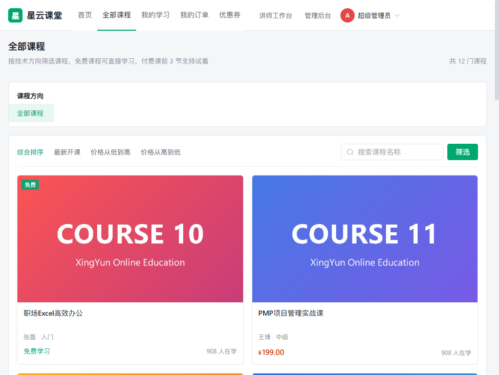

左侧为两级分类树，右侧为课程卡片列表。支持关键词、分类、难度、是否免费与排序（热门 / 最新 / 价格），搜索条件同步到 URL，可直接分享链接；列表为空时提供「清空筛选条件」的真实引导。

#### 4.2.3 课程详情


展示封面、讲师、课时数、学习人数、评分与难度。免费课程直接开放，付费课程前 3 节可试看。页面含课程介绍、章节目录、课件资料、课程评论四个页签，另设课程问答区；购买流程使用行式「确认订单」弹窗，金额与优惠券由后端重算。

#### 4.2.4 在线学习

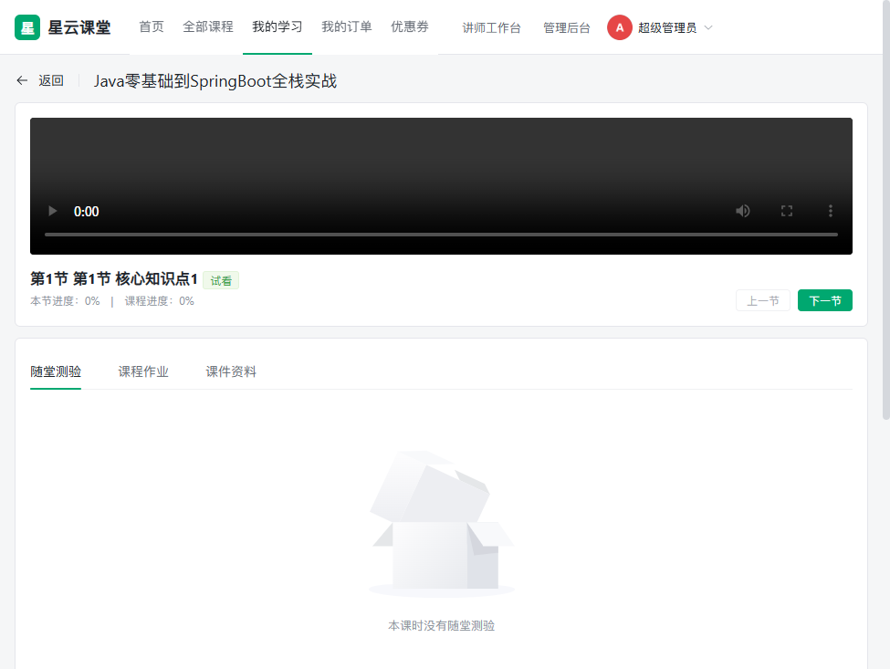

视频地址由后端签名后下发，签名有效期 5 分钟，支持 Range 拖动与断点续播。学习进度每 5 秒节流上报，按课时唯一键更新，全部学完自动颁发证书。右侧课程目录标记试看、已完成与锁定状态；课时结束后自动切换到下一节。随堂测验在服务端判分，题目接口不下发正确答案；离开页面前（组件卸载与 `beforeunload`）会补报一次最新进度，保证续播位置准确。

#### 4.2.5 我的学习

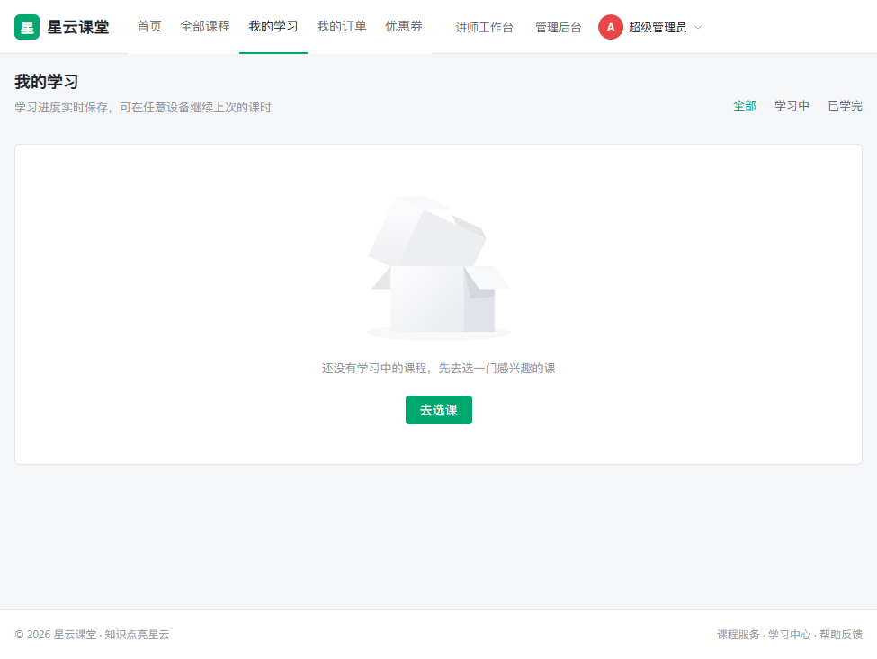

按「全部 / 学习中 / 已学完」筛选，展示课时完成数、课程进度与继续学习入口。封面加载失败时回退为首字母占位，避免裂图。

### 4.3 讲师端

#### 4.3.1 数据看板


展示我的课程、累计学员、累计播放、待批改作业、待回复问答与课程收入，下方为待处理事项入口。

#### 4.3.2 课程管理

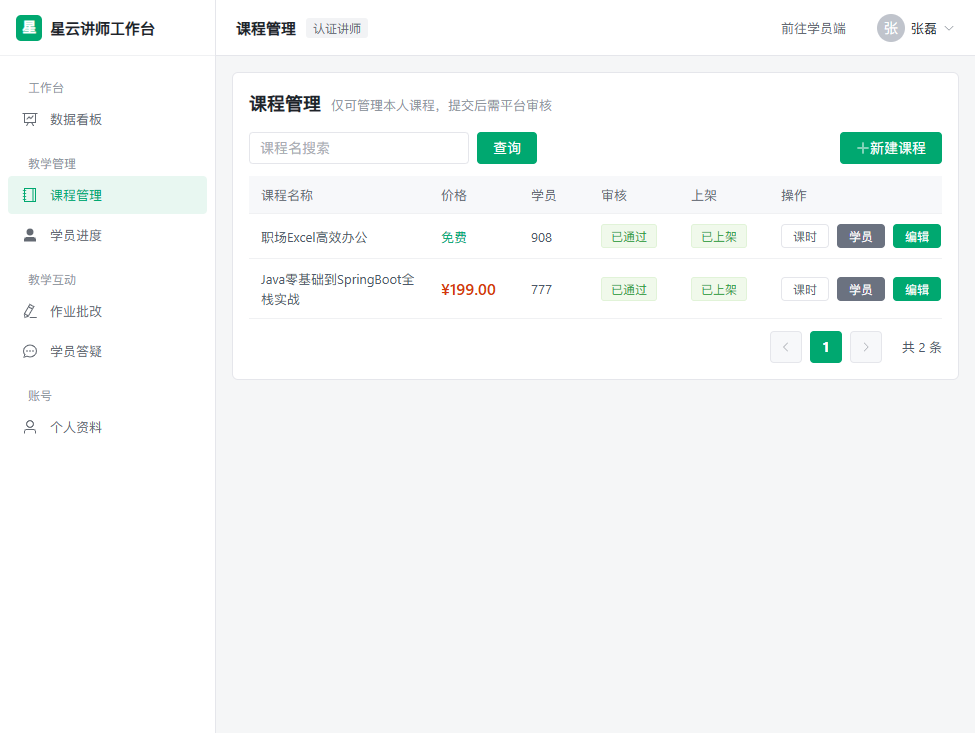

讲师可新建或编辑本人课程并提交平台审核，支持课时维护、学员进度查看、上下架与逻辑删除。

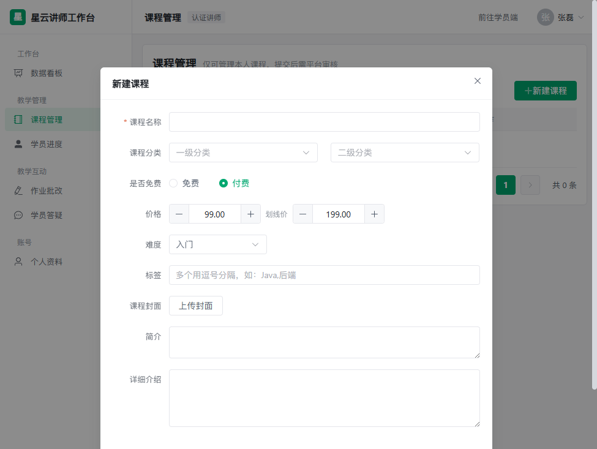

弹窗采用小圆角与半透明遮罩，表单标签左对齐，主按钮居右，符合后台系统通用交互习惯。

#### 4.3.3 学员进度

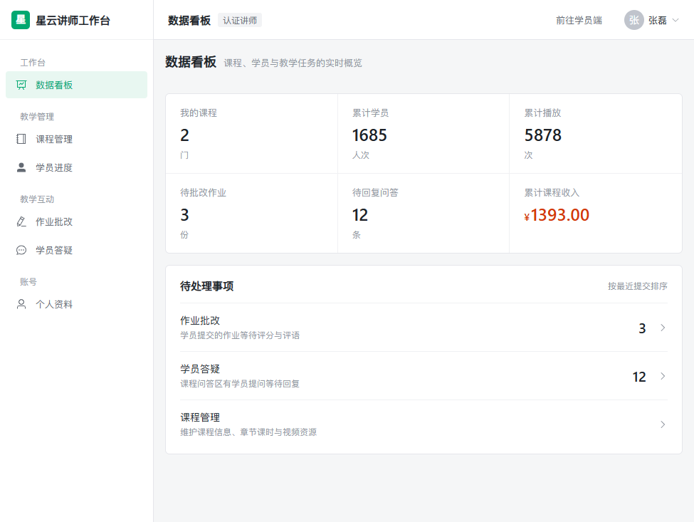

按课程查看报名人数、已学完全部课时人数、平均学习进度与每位学员的最近学习时间。

### 4.4 管理后台

#### 4.4.1 运营大盘


展示销售总额、订单数、学员数、课程数等指标，并以实色图表呈现分类课程分布与近 7 日新增学员。指标面板使用 1px 描边与单元格分隔线，不使用阴影和渐变。

#### 4.4.2 用户管理

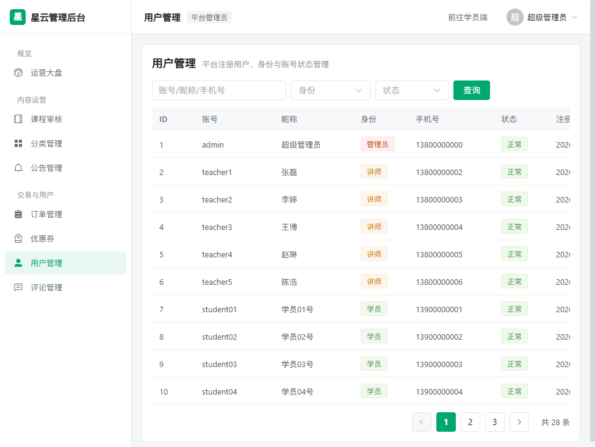

支持按账号、身份、状态检索；可禁用/启用账号、重置密码。禁用后该用户的旧 Token 会立即失效，管理员不能禁用或重置自己的账号。

#### 4.4.3 课程审核

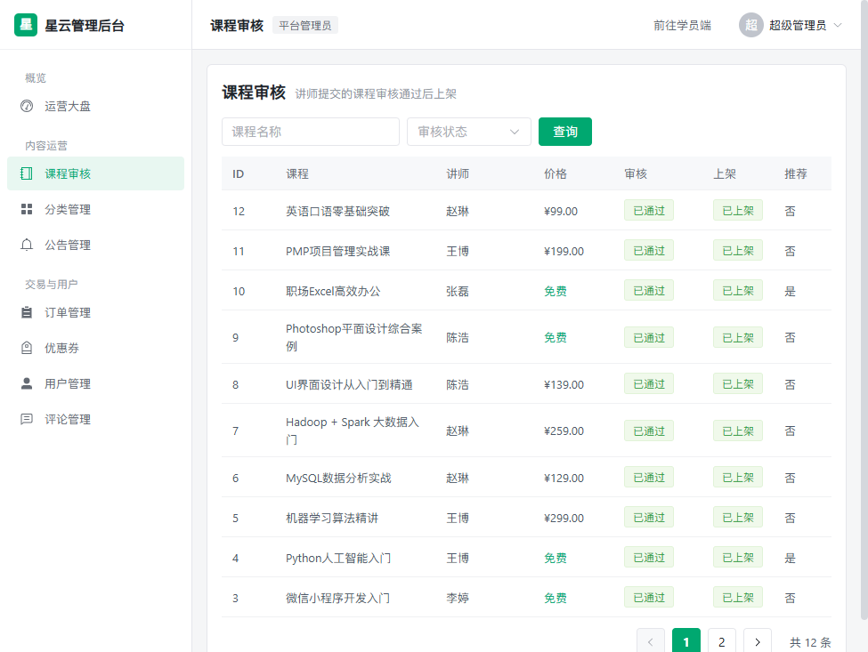

讲师提交的课程需管理员审核通过后上架，驳回时必须填写原因。管理员还可调整推荐位与上下架状态。

---

## 五、技术架构

### 5.1 总体架构

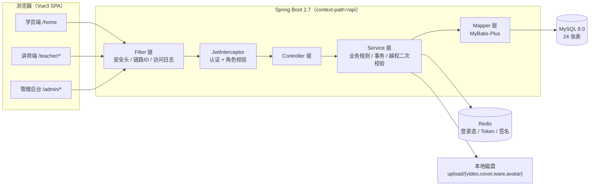

### 5.2 技术选型

| 层次       | 技术 / 版本                 | 选型说明                                     |
| ---------- | --------------------------- | -------------------------------------------- |
| 后端框架   | Spring Boot 2.7.18          | 生态成熟、自动配置完善，适合单体应用快速交付 |
| 持久层     | MyBatis-Plus 3.5.5          | 保留 SQL 可控性，同时减少单表 CRUD 样板代码  |
| 数据库     | MySQL 8.0                   | 事务与索引能力稳定，便于统计聚合             |
| 缓存       | Redis 5.x                   | 存储登录态、视频签名与去重标记               |
| 鉴权       | JJWT 0.11.5                 | 无状态 JWT + Redis 双向校验                  |
| 工具       | Hutool 5.8.25、Lombok       | 简化加密、日期、文件与样板代码               |
| 观测       | Spring Boot Actuator        | 健康检查与运行指标，供负载均衡探活           |
| 前端框架   | Vue 3.4.31 + Vite 5.3.3     | 组合式 API，开发热更新快，构建可按依赖分包   |
| 组件库     | Element Plus 2.7.6          | 企业后台组件完备，支持 CSS 变量定制          |
| 状态与路由 | Pinia 2.1.7、Vue Router 4.4 | 轻量状态管理与三端路由守卫                   |
| 请求层     | Axios 1.7.2                 | 拦截器统一注入 Token 与解包响应              |

### 5.3 后端分层与请求链路

```mermaid
sequenceDiagram
    participant B as 浏览器
    participant F as Filter 链
    participant J as JwtInterceptor
    participant C as Controller
    participant S as Service
    participant DB as MySQL / Redis

    B->>F: HTTP 请求（Bearer Token）
    F->>F: 生成 X-Request-Id、写入 MDC、追加安全响应头
    F->>J: 放行
    J->>J: 白名单判断 / Token 校验 / 角色校验
    alt 未登录或登录态失效
        J-->>B: 401 Result
    else 角色不匹配
        J-->>B: 403 Result
    else 校验通过
        J->>C: 注入当前用户
        C->>S: 调用业务方法
        S->>S: 数据级越权校验、事务、幂等判断
        S->>DB: 读写数据
        S-->>C: 返回业务对象
        C-->>B: Result{code,msg,data}
    end
```

工程分层遵循 `controller → service → mapper`，DTO 负责入参校验，VO 负责出参裁剪，实体不直接暴露给前端。业务异常统一由全局处理器转换为 400，未知异常返回 500 且不回显堆栈。

### 5.4 认证与权限流程

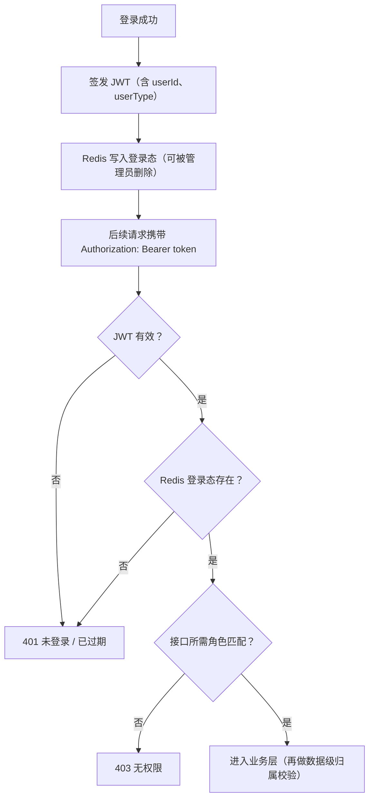

角色定义：`userType = 1` 学员、`2` 讲师、`3` 管理员。讲师访问他人课程、课时、作业、问答时，Service 层会再次校验数据归属，避免仅靠前端隐藏菜单造成越权。Redis 登录态键为 `xingyun:token:{userId}`，有效期 24 小时，删除即踢下线。

### 5.5 视频防盗链链路

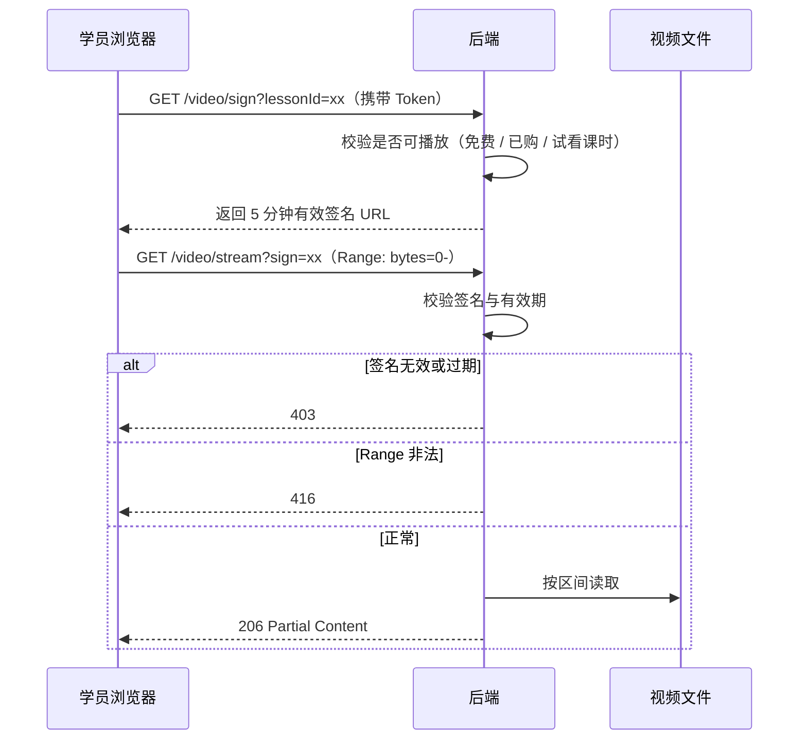

`upload/video` 目录不配置静态映射，无法通过猜测文件路径直接访问；封面、头像、课件通过 `/upload` 前缀访问。签名存放于 Redis（键 `xingyun:video:sign:{sign}`，TTL 300 秒）。

### 5.6 前端架构

- **布局层**：`StudentLayout`、`TeacherLayout`、`AdminLayout` 三套布局，按路由前缀挂载。
- **路由层**：懒加载 + 全局前置守卫（登录态、角色、公开页判断），`afterEach` 统一设置页面标题，`scrollBehavior` 回到顶部并支持前进后退恢复。
- **状态层**：Pinia 仅保存登录用户信息，持久化到 `localStorage` 并在读取时做安全解析。
- **请求层**：Axios 统一注入 Token、解包 `Result`、处理 401/403 与超时/断网提示；支持 `VITE_API_BASE` 指向独立网关。
- **设计系统**：`styles/global.css` 定义颜色、间距、圆角令牌并覆盖 Element Plus 变量，业务页面只使用语义化工具类。
- **构建策略**：`vue`、`element-plus`、`vendor` 独立分包，业务迭代可复用框架缓存。

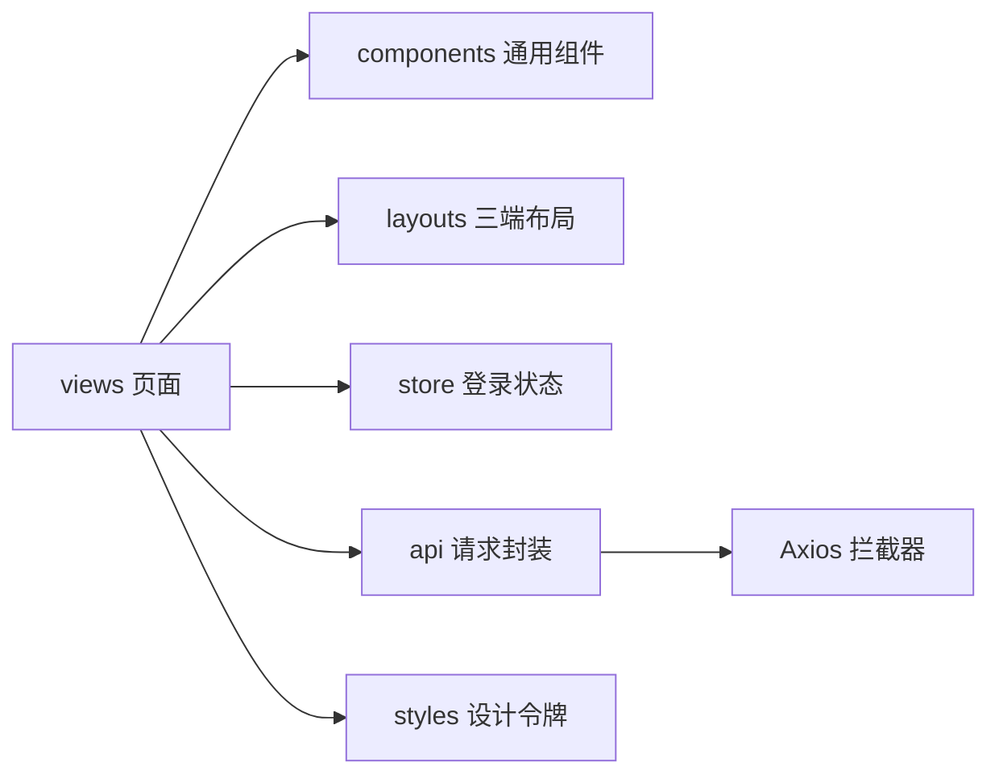

---

## 六、数据库设计

### 6.1 通用规范

- 数据库 `xingyun`，字符集 `utf8mb4`（`utf8mb4_general_ci`），引擎 InnoDB。
- 业务表统一包含 `create_time`、`update_time`、`is_deleted`（MyBatis-Plus 全局逻辑删除，删除即 UPDATE 标记）。
- 主键 `BIGINT AUTO_INCREMENT`；金额统一 `DECIMAL(10,2)`；状态统一 `TINYINT` 并在注释中写明取值。
- 建表脚本 `sql/01_xingyun_schema.sql`，演示数据 `sql/02_xingyun_data.sql`，存量库索引增量 `sql/03_xingyun_optimize.sql`。

### 6.2 表分组总览（24 张表）

| 领域       | 数据表                                                                                    |
| ---------- | ----------------------------------------------------------------------------------------- |
| 权限       | `sys_user`、`sys_role`、`sys_user_role`                                                   |
| 课程       | `course_category`、`course`、`course_lesson`、`video_resource`、`course_ware`             |
| 学习       | `learn_progress`、`play_record`、`quiz`、`quiz_question`、`quiz_answer`、`wrong_question` |
| 作业       | `assignment`、`assignment_submission`                                                     |
| 交易       | `course_order`、`coupon`、`user_coupon`                                                   |
| 互动与服务 | `course_comment`、`course_qa`、`certificate`、`announcement`、`course_favorite`           |

### 6.3 核心表字段与索引要点

**权限领域**

| 表名          | 核心字段                                                                                                       | 索引与关系                                                        |
| ------------- | -------------------------------------------------------------------------------------------------------------- | ----------------------------------------------------------------- |
| `sys_user`    | `username` 唯一、`password` BCrypt、`nickname`、`user_type`（1/2/3）、`status`（0/1）、`study_minutes`、`integral`、`last_login_time` | `uk_username`、`idx_user_type`、`idx_status`、`idx_create_time`   |
| `sys_role`    | `role_code`（STUDENT/TEACHER/ADMIN）、`role_name`、`description`                                              | `uk_role_code`                                                    |
| `sys_user_role` | `user_id`、`role_id`                                                                                         | `uk_user_role(user_id,role_id)`，用户—角色多对多                  |

**课程领域**

| 表名              | 核心字段                                                                                                                                                       | 索引与关系                                                              |
| ----------------- | -------------------------------------------------------------------------------------------------------------------------------------------------------------- | ----------------------------------------------------------------------- |
| `course_category` | `parent_id`（0 为一级）、`name`、`level`、`icon`、`sort`、`status`                                                                                             | `idx_parent`，两级自关联                                                |
| `course`          | `course_name`、`cover`、`teacher_id`、`category_id` / `category2_id`、`price` / `original_price`、`is_free`、`difficulty`、`lesson_count` / `total_duration`、`student_count` / `view_count`、`score`、`audit_status`（0/1/2/3）、`reject_reason`、`status`（0/1）、`is_recommend` | `idx_teacher`、`idx_category`、`idx_status`、`idx_hot(audit_status,status,student_count)` |
| `course_lesson`   | `course_id`、`chapter`、`lesson_name`、`video_id`、`duration`（秒，进度权威值）、`sort`、`is_free_trial`、`status`                                              | `idx_course_sort(course_id,sort)`，课时属于课程                         |
| `video_resource`  | `file_path`（相对路径）、`md5`、`duration`、`size`、`play_count`                                                                                               | `idx_md5`，按 MD5 去重                                                  |
| `course_ware`     | `course_id`、`lesson_id`（0 为课程级）、`file_path`、`file_type`、`file_name`                                                                                  | `idx_course`                                                            |

**学习领域**

| 表名              | 核心字段                                                                                                       | 索引与关系                                          |
| ----------------- | -------------------------------------------------------------------------------------------------------------- | --------------------------------------------------- |
| `learn_progress`  | `user_id` + `lesson_id` 唯一、`progress`（0–100）、`position_seconds`、`learned_seconds`、`status`（0/1）、`finish_time` | `uk_user_lesson`、`idx_user_course`，按唯一键 upsert |
| `play_record`     | `user_id`、`lesson_id`、`play_time`                                                                             | `idx_user_time`、`idx_lesson`、`idx_user_lesson`     |
| `quiz`            | `lesson_id`、`title`、`pass_score`、`status`                                                                   | `idx_lesson`，测验挂在课时                          |
| `quiz_question`   | `quiz_id`、`question_type`（1 单选 / 2 多选 / 3 判断）、`content`、`options`、`answer`、`analysis`、`sort`      | `idx_quiz`                                          |
| `quiz_answer`     | `user_id`、`quiz_id`、`question_id`、`user_answer`、`is_right`                                                 | `idx_user_quiz`                                     |
| `wrong_question`  | `user_id` + `question_id` 唯一、`wrong_count`、`last_wrong_time`                                               | `uk_user_question`                                  |

**作业领域**

| 表名                    | 核心字段                                                                                                     | 索引与关系                                             |
| ----------------------- | ------------------------------------------------------------------------------------------------------------ | ------------------------------------------------------ |
| `assignment`            | `course_id`、`lesson_id`、`teacher_id`、`title`、`content`（作业要求）、`total_score`                        | `idx_course`、`idx_teacher`                            |
| `assignment_submission` | `assignment_id` + `user_id` 唯一、`content`、`attachment`、`score`、`teacher_comment`、`grade_status`（0 待批 / 1 已批 / 2 打回） | `uk_assignment_user`、`idx_user`、`idx_status`          |

**交易领域**

| 表名          | 核心字段                                                                                                                       | 索引与关系                                          |
| ------------- | ------------------------------------------------------------------------------------------------------------------------------ | --------------------------------------------------- |
| `course_order` | `order_no` 唯一、`user_id`、`course_id`、`original_amount` / `discount_amount` / `pay_amount`、`coupon_id`、`pay_type`、`status`（0 待支付 / 1 已支付 / 2 已取消 / 3 已退款） | `uk_order_no`、`idx_user_status`、`idx_course`      |
| `coupon`      | `name`、`coupon_type`（1 满减 / 2 立减 / 3 折扣）、`threshold`、`discount_value`、`valid_days`、`total_count`、`receive_count` | 主键查询，库存条件原子扣减                          |
| `user_coupon` | `user_id` + `coupon_id` 唯一、`expire_time`、`status`（0 未用 / 1 已用 / 2 过期）                                              | `uk_user_coupon`、`idx_status`                      |

**互动与服务领域**

| 表名              | 核心字段                                                                                       | 索引与关系                                     |
| ----------------- | ---------------------------------------------------------------------------------------------- | ---------------------------------------------- |
| `course_comment`  | `course_id`、`user_id`、`content`、`score`（1–5）、`status`（0 屏蔽 / 1 显示）                  | `idx_course(course_id,status)`                 |
| `course_qa`       | `course_id`、`user_id`、`question`、`reply_content`、`replier`、`reply_time`、`status`（0/1）   | `idx_course_status`、`idx_user`                 |
| `certificate`     | `cert_no` 唯一、`user_id` + `course_id` 唯一、`course_name` 快照、`issue_time`                  | `uk_cert_no`、`uk_user_course`，幂等防重复发证  |
| `announcement`    | `title`、`content`、`type`（1 通知 / 2 活动）、`status`（0 草稿 / 1 发布）、`publish_time`      | `idx_status_time`                              |
| `course_favorite` | `user_id`、`course_id`                                                                         | `uk_user_course`                               |

### 6.4 主要关联关系

```text
sys_user ─┬─ sys_user_role ─ sys_role                  用户—角色：多对多
          ├─ course_order ─ course                      学员—课程：多对多，订单承载
          ├─ user_coupon ─ coupon                       用户—优惠券：多对多
          ├─ learn_progress / play_record → course_lesson → course
          ├─ quiz_answer / wrong_question → quiz_question → quiz → course_lesson
          ├─ assignment_submission → assignment → course
          ├─ course_comment / course_qa / course_favorite → course
          └─ certificate → course
course_category：自关联两级分类（parent_id=0 为一级）→ course
```

### 6.5 索引设计说明

| 索引                                         | 表            | 服务场景                                             |
| -------------------------------------------- | ------------- | ---------------------------------------------------- |
| `idx_create_time(create_time)`               | `sys_user`    | 管理大盘「近 7 天新增用户」按日分组统计              |
| `idx_hot(audit_status,status,student_count)` | `course`      | 首页热门课程「审核通过 + 上架，按学习人数排序」      |
| `idx_user_lesson(user_id,lesson_id)`         | `play_record` | 学习行为统计，按用户 + 课时过滤播放流水              |
| `idx_teacher(teacher_id)`                    | `assignment`  | 讲师待批作业统计                                     |

存量库执行一次 `sql/03_xingyun_optimize.sql` 即可补齐；新建库已包含在 `01_xingyun_schema.sql` 中，无需重复执行。

---

## 七、接口说明

### 7.1 统一约定

- **Base URL**：开发 `http://127.0.0.1:8080/api`（Vite 代理）；生产由 Nginx 转发 `/api` 到后端。
- **鉴权**：除标注「公开」外，均需请求头 `Authorization: Bearer <token>`。
- **角色**：1 学员 / 2 讲师 / 3 管理员；拦截器按 URL 前缀鉴权，Service 层再做数据级归属校验。
- **单位**：金额为元（`DECIMAL(10,2)`），时长为秒。
- **分页参数**：`page` 默认 1，`size` 默认 10（最大 100）。

统一返回结构：

```json
{
  "code": 200,
  "msg": "成功",
  "data": {}
}
```

分页数据结构：`PageResult{records,total,current,size}`。

### 7.2 认证与公开接口

| 方法 | 路径                 | 鉴权     | 说明                                                                 |
| ---- | -------------------- | -------- | -------------------------------------------------------------------- |
| POST | `/auth/login`        | 公开     | 登录，入参 `username` / `password`，返回 `token` 与 `userInfo`       |
| POST | `/auth/register`     | 公开     | 注册学员，用户名 4–20 位、密码 6–20 位                              |
| POST | `/auth/logout`       | 登录     | 登出并删除 Redis 登录态                                              |
| GET  | `/auth/info`         | 登录     | 当前登录用户完整信息                                                 |
| PUT  | `/auth/profile`      | 登录     | 修改昵称、性别、头像、邮箱、手机、简介、头衔                         |
| PUT  | `/auth/password`     | 登录     | 修改密码，新旧密码不可相同                                           |
| GET  | `/category/tree`     | 公开     | 两级分类树                                                           |
| GET  | `/announcement/list` | 公开     | 已发布公告，可按 `type` 筛选                                         |

### 7.3 课程与浏览

| 方法 | 路径                | 鉴权          | 说明                                                                                       |
| ---- | ------------------- | ------------- | ------------------------------------------------------------------------------------------ |
| POST | `/course/page`      | 公开          | 分页检索，支持关键词、两级分类、难度、是否免费、排序（hot/new/price_asc）                  |
| GET  | `/course/detail/{id}` | 公开（可选登录） | 课程详情：章节目录、`canPlay` 权限、进度、是否已购；已登录用户可拿到进度与购买状态         |
| GET  | `/course/hot`       | 公开          | 热门推荐课程，`limit` 默认 8                                                               |
| GET  | `/course/my`        | 登录          | 我的课程（已购 + 免费在学）                                                                |
| GET  | `/teacher/list`     | 公开          | 讲师列表，支持 `keyword`                                                                   |
| GET  | `/teacher/detail/{id}` | 公开       | 讲师详情                                                                                   |

### 7.4 学习与视频

| 方法 | 路径                    | 鉴权          | 说明                                                                                                     |
| ---- | ----------------------- | ------------- | -------------------------------------------------------------------------------------------------------- |
| POST | `/learn/report`         | 登录          | 进度上报，入参 `courseId` / `lessonId` / `positionSec`；返回课时进度、课程进度与 `newCertificate`；含可播放校验 |
| GET  | `/learn/continue`       | 登录          | 断点续播位置，参数 `courseId`                                                                            |
| GET  | `/learn/profile`        | 登录          | 个人学习档案（学习分钟、积分、课程数）                                                                   |
| POST | `/video/sign`           | 登录          | 申请播放签名，入参 `lessonId`，返回 5 分钟有效签名                                                       |
| GET  | `/video/stream`         | 公开（凭签名） | 视频流输出，支持 Range；非法或越界 Range 返回 416                                                        |
| GET  | `/video/library`        | 讲师 + 管理员 | 视频资源库                                                                                               |

### 7.5 测验、作业与互动

| 方法 | 路径                        | 鉴权 | 说明                                                                 |
| ---- | --------------------------- | ---- | -------------------------------------------------------------------- |
| GET  | `/quiz/byLesson/{lessonId}` | 登录 | 获取测验与题目，答案不下发                                           |
| POST | `/quiz/submit`              | 登录 | 交卷判分，返回得分、对错与每题解析                                   |
| GET  | `/quiz/wrongBook`           | 登录 | 我的错题本                                                           |
| GET  | `/assignment/list/{courseId}` | 登录 | 课程作业列表，含我的提交状态                                       |
| POST | `/assignment/submit`        | 登录 | 提交或重交作业                                                       |
| GET  | `/comment/list/{courseId}`  | 登录 | 课程评论列表                                                         |
| POST | `/comment/add`              | 登录 | 发表评论，内容 ≤500 字、评分 1–5；已购或免费才可评论                 |
| GET  | `/qa/list/{courseId}`       | 登录 | 课程问答列表                                                         |
| POST | `/qa/ask`                   | 登录 | 提问，问题 ≤1000 字                                                  |
| POST | `/favorite/toggle/{courseId}` | 登录 | 收藏或取消收藏                                                     |
| GET  | `/favorite/my`              | 登录 | 我的收藏                                                             |

### 7.6 订单、优惠券与证书

| 方法 | 路径                  | 鉴权 | 说明                                                       |
| ---- | --------------------- | ---- | ---------------------------------------------------------- |
| POST | `/order/create`       | 登录 | 创建订单，金额由后端重算，可传 `userCouponId`              |
| POST | `/order/pay`          | 登录 | 模拟支付，按订单号幂等，重复支付不重复加权益               |
| POST | `/order/cancel/{id}`  | 登录 | 取消待支付订单                                             |
| GET  | `/order/my`           | 登录 | 我的订单，可按状态筛选                                     |
| GET  | `/coupon/available`   | 登录 | 可领取优惠券                                               |
| POST | `/coupon/receive/{id}` | 登录 | 领取优惠券，防重复、原子扣库存                            |
| GET  | `/coupon/my`          | 登录 | 我的优惠券（0 未用 / 1 已用 / 2 过期，自动判过期）         |
| GET  | `/cert/my`            | 登录 | 我的证书                                                   |
| GET  | `/cert/detail/{id}`   | 登录 | 证书详情                                                   |

### 7.7 讲师端

| 方法   | 路径                                  | 鉴权          | 说明                                         |
| ------ | ------------------------------------- | ------------- | -------------------------------------------- |
| GET    | `/teacher/stat`                       | 讲师 + 管理员 | 讲师数据看板                                 |
| POST   | `/teacher/course/page`                | 讲师 + 管理员 | 我的课程分页                                 |
| POST   | `/teacher/course/save`                | 讲师 + 管理员 | 新增或编辑课程，仅本人课程                   |
| DELETE | `/teacher/course/{id}`                | 讲师 + 管理员 | 删除课程，仅本人                             |
| POST   | `/teacher/course/shelf`               | 讲师 + 管理员 | 上下架，仅本人课程，越权返回 403             |
| POST   | `/teacher/lesson/save`                | 讲师 + 管理员 | 新增或编辑课时                               |
| DELETE | `/teacher/lesson/{id}`                | 讲师 + 管理员 | 删除课时                                     |
| GET    | `/teacher/video/library`              | 讲师 + 管理员 | 视频库                                       |
| GET    | `/teacher/course/students/{courseId}` | 讲师 + 管理员 | 课程学员进度，仅本人课程                     |
| GET    | `/teacher/assignment/submissions`     | 讲师 + 管理员 | 作业提交列表，可按批改状态筛选               |
| POST   | `/teacher/assignment/grade`           | 讲师 + 管理员 | 批改作业，分数 0–100，可填评语与状态         |
| GET    | `/teacher/qa/pending`                 | 讲师 + 管理员 | 待答问题                                     |
| POST   | `/teacher/qa/reply`                   | 讲师 + 管理员 | 回复问题                                     |

### 7.8 管理后台

| 方法   | 路径                            | 鉴权   | 说明                                             |
| ------ | ------------------------------- | ------ | ------------------------------------------------ |
| GET    | `/admin/dashboard`              | 管理员 | 运营大盘（SQL 聚合统计）                         |
| POST   | `/admin/user/page`              | 管理员 | 用户分页，支持账号、身份、状态筛选               |
| POST   | `/admin/user/status`            | 管理员 | 启用或禁用，禁用即踢下线；不能操作自己           |
| POST   | `/admin/user/resetPwd/{id}`     | 管理员 | 重置密码为默认值；不能操作自己                   |
| POST   | `/admin/course/page`            | 管理员 | 全课程分页，含审核状态                           |
| POST   | `/admin/course/audit`           | 管理员 | 审核，`auditStatus` 仅 2/3，驳回必须填原因       |
| POST   | `/admin/course/shelf`           | 管理员 | 上下架                                           |
| POST   | `/admin/course/recommend`       | 管理员 | 设置或取消推荐                                   |
| DELETE | `/admin/course/{id}`            | 管理员 | 删除课程                                         |
| POST   | `/admin/order/page`             | 管理员 | 订单分页                                         |
| POST   | `/admin/comment/page`           | 管理员 | 评论分页                                         |
| POST   | `/admin/comment/status`         | 管理员 | 屏蔽或恢复评论                                   |
| GET    | `/admin/category/list`          | 管理员 | 全部分类                                         |
| POST   | `/admin/category/save`          | 管理员 | 新增或编辑分类                                   |
| DELETE | `/admin/category/{id}`          | 管理员 | 删除分类，有子分类或课程时拒绝                   |
| GET    | `/admin/coupon/list`            | 管理员 | 优惠券列表                                       |
| POST   | `/admin/coupon/save`            | 管理员 | 新增或编辑优惠券                                 |
| DELETE | `/admin/coupon/{id}`            | 管理员 | 删除优惠券                                       |
| GET    | `/admin/announcement/list`      | 管理员 | 公告列表                                         |
| POST   | `/admin/announcement/save`      | 管理员 | 发布或编辑公告                                   |
| DELETE | `/admin/announcement/{id}`      | 管理员 | 删除公告                                         |

### 7.9 文件上传与健康检查

| 方法 | 路径                 | 鉴权 | 说明                                                                                                   |
| ---- | -------------------- | ---- | ------------------------------------------------------------------------------------------------------ |
| POST | `/upload`            | 登录 | 表单字段 `file` + `type`（cover/avatar/ware/video）；封面/头像/课件 10MB，视频 500MB；后缀白名单校验 |
| GET  | `/actuator/health`   | 公开 | 健康检查，含 liveness/readiness 探针，供负载均衡与容器编排使用                                          |

视频上传只返回 `videoId` 与 `filePath`，不返回可直链 URL；其余类型返回 `{url, filePath}`。

### 7.10 鉴权矩阵

| 前缀                                                                                          | 学员 | 讲师 | 管理员 | 游客 |
| --------------------------------------------------------------------------------------------- | ---- | ---- | ------ | ---- |
| `/auth` 登录注册、`/category`、`/course` 浏览、`/announcement`、`/teacher/list` / `detail`     | ✅   | ✅   | ✅     | ✅   |
| `/course/my`、`/learn`、`/video/sign`、`/quiz`、`/assignment`、`/comment`、`/qa`、`/favorite`、`/order`、`/coupon`、`/cert` | ✅   | ✅   | ✅     | ❌   |
| `/teacher/**` 管理类                                                                          | ❌   | ✅   | ✅     | ❌   |
| `/admin/**`                                                                                   | ❌   | ❌   | ✅     | ❌   |

### 7.11 主要错误码

| code | 含义             | 典型场景                                 |
| ---- | ---------------- | ---------------------------------------- |
| 200  | 成功             | 正常业务返回                             |
| 400  | 参数或业务错误   | 校验失败、业务规则不满足、审核参数非法   |
| 401  | 未登录或已过期   | 缺少 Token、Token 过期、登录态被删除     |
| 403  | 无权限           | 角色不符、数据级越权、签名无效           |
| 404  | 资源不存在       | 课程、订单、证书不存在                   |
| 405  | 请求方法不支持   | 用错 HTTP Method                         |
| 416  | Range 不满足     | 视频请求区间畸形或越界                   |
| 500  | 系统异常         | 未捕获异常，响应不含堆栈与内部路径       |

---

## 八、使用指南

### 8.1 环境要求

| 软件    | 版本要求        | 说明                         |
| ------- | --------------- | ---------------------------- |
| JDK     | 17              | 后端编译与运行               |
| Maven   | 3.8+（建议 3.9） | 依赖管理与打包               |
| Node.js | 18+（建议 20+） | 前端开发与构建               |
| npm     | 9+              | 随 Node 安装                 |
| MySQL   | 8.0             | 业务数据库，字符集 `utf8mb4` |
| Redis   | 5.0+            | 登录态与签名存储，默认 6379  |

### 8.2 五步启动

#### 步骤 1：启动基础服务

启动 MySQL 与 Redis，确认可连接：

```bash
mysql -uroot -p -e "SELECT VERSION();"
redis-cli ping   # 期望返回 PONG
```

#### 步骤 2：初始化数据库与占位资源

按顺序执行 `sql` 目录脚本：

```bash
mysql -uroot -p < sql/01_xingyun_schema.sql
mysql -uroot -p < sql/02_xingyun_data.sql
# 存量库升级时再执行
mysql -uroot -p < sql/03_xingyun_optimize.sql
```

首次运行还需生成封面、头像占位图，否则页面会裂图：

```powershell
cd xingyun-server
powershell -ExecutionPolicy Bypass -File .\gen_placeholders.ps1
# 期望输出 covers generated: 12 / avatars generated: 26 / DONE
```

#### 步骤 3：启动后端

```powershell
cd xingyun-server
mvn package "-Dmaven.test.skip=true"
java -jar target\xingyun-server.jar
```

启动成功后访问 `http://localhost:8080/api/actuator/health`，应返回 `{"status":"UP"}`。

#### 步骤 4：启动前端

```powershell
cd xingyun-ui
npm install
npm run dev
```

浏览器访问 `http://localhost:5173`。Vite 已将 `/api` 与 `/upload` 代理到 8080，开发期无需额外配置跨域。

#### 步骤 5：登录体验

使用[第二章账号清单](#22-完整账号清单)中的任一账号登录。重启顺序为「数据库 → 后端 → 前端」，关闭顺序相反。

### 8.3 配置说明

开发环境默认连接本机 MySQL（`root/123456`，库 `xingyun`）与 Redis（`localhost:6379`），可在 `xingyun-server/src/main/resources/application-dev.yml` 调整。

生产环境使用 `--spring.profiles.active=prod`，敏感配置全部通过环境变量注入，缺失必填项会直接启动失败：

| 变量                                          | 必填 | 说明                                            |
| --------------------------------------------- | ---- | ----------------------------------------------- |
| `XINGYUN_DB_URL`                              | 是   | JDBC 连接串（Hikari 连接池 min 10 / max 30）    |
| `XINGYUN_DB_USERNAME` / `XINGYUN_DB_PASSWORD` | 是   | 数据库账号                                      |
| `XINGYUN_REDIS_HOST` / `XINGYUN_REDIS_PORT`   | 是   | Redis 地址                                      |
| `XINGYUN_REDIS_PASSWORD`                      | 否   | Redis 密码                                      |
| `XINGYUN_JWT_SECRET`                          | 是   | 至少 32 字节，启动时校验强度                    |
| `XINGYUN_UPLOAD_PATH`                         | 是   | 上传根目录，建议独立数据盘                      |
| `XINGYUN_CORS_ORIGINS`                        | 是   | 前端域名白名单，逗号分隔                        |
| `XINGYUN_LOG_PATH`                            | 否   | 日志目录，默认 `./logs`，50MB 滚动 / 保留 30 天 |

前端如需指向独立网关，可在 `.env.production` 中设置 `VITE_API_BASE`。

### 8.4 生产部署与 Nginx

```bash
# 前端构建，产物位于 dist/
cd xingyun-ui
npm run build

# 后端启动（生产配置）
java -jar xingyun-server.jar --spring.profiles.active=prod
```

后端建议用 nssm / WinSW（Windows）或 systemd（Linux）注册为系统服务，并限制 `-Xmx` 以适配机器内存。Nginx 关键配置：

```nginx
server {
  listen 80;
  server_name edu.example.com;
  root /var/www/xingyun/dist;

  location / {
    try_files $uri $uri/ /index.html;   # Vue history 路由
  }
  location /api/ {
    proxy_pass http://127.0.0.1:8080/api/;
    proxy_set_header Host $host;
    proxy_set_header X-Real-IP $remote_addr;
    proxy_set_header X-Forwarded-For $proxy_add_x_forwarded_for;
  }
  location /upload/ {
    proxy_pass http://127.0.0.1:8080/api/upload/;
  }
  client_max_body_size 520m;            # 与后端上传上限一致
}
```

### 8.5 运维与备份

| 事项         | 说明                                                                                     |
| ------------ | ---------------------------------------------------------------------------------------- |
| 后端日志     | 控制台或重定向输出；每个请求带 `X-Request-Id` 并写入 MDC，日志格式统一携带 traceId       |
| 日志滚动     | 生产默认 50MB 滚动、保留 30 天、总量上限 2GB，目录由 `XINGYUN_LOG_PATH` 指定             |
| SQL 日志     | 开发环境打印 SQL，生产环境已关闭                                                         |
| Redis 登录态 | 键 `xingyun:token:{userId}`（24 小时），清空即全员下线                                    |
| 视频签名     | 键 `xingyun:video:sign:{sign}`（5 分钟），过期自动失效                                    |
| 数据库备份   | 每日 `mysqldump --single-transaction --routines xingyun > backup_日期.sql`，保留最近 N 天并异地拷贝 |
| 上传目录备份 | `upload/` 整体拷贝；视频体积大，建议独立数据盘并监控磁盘水位                             |
| 恢复演练     | 定期按「建库 → 01 → 02 → 最新备份」流程演练，能恢复才算有效                              |
| 健康检查     | `GET /api/actuator/health`，优雅停机 30s，HTTP 响应压缩                                  |

### 8.6 常见问题

| 现象                             | 排查方向                                                              |
| -------------------------------- | --------------------------------------------------------------------- |
| 后端启动报 JWT 密钥过短          | `XINGYUN_JWT_SECRET` 至少 32 字节                                     |
| 后端启动报数据库连接失败         | MySQL 未启动或密码不符；确认 `application-dev.yml`                    |
| 后端端口 8080 被占用             | `netstat -ano | findstr :8080` 查 PID 后结束进程                      |
| 前端页面 404                     | Nginx 未配置 `try_files ... /index.html`                              |
| 前端 `proxy error`               | 后端未启动或端口被占用                                                |
| 图片 / 头像裂图                  | `/upload` 未反代到后端、占位资源未生成，或上传目录无读取权限           |
| 登录后立即跳回登录页             | Redis 未启动，或该账号已被管理员禁用                                  |
| 视频无法播放或不能拖动           | 签名过期（5 分钟）需重新获取；Range 畸形返回 416 属正常保护            |
| 上传视频失败                     | Nginx `client_max_body_size` 或后端 multipart 上限不足                 |
| 修改后端代码不生效               | 需重新打包并重启 jar                                                  |
| PowerShell 执行测试脚本乱码      | 脚本需保持 UTF-8 BOM 编码，断言按 `code` 而非中文匹配                  |
| 页面字段为空但接口有数据         | 前后端字段名不一致，核对 `name` / `cover` / `difficulty` / `filePath`  |

---

## 九、测试与质量保障

### 9.1 接口回归

```powershell
cd xingyun-server
powershell -ExecutionPolicy Bypass -File .\test-api.ps1
```

回归脚本共 49 项用例，覆盖三角色登录、公开接口、受保护接口、401/403 负向用例、下单支付、视频签名、进度上报、测验判分、作业提交批改、评论问答收藏、讲师端与管理端、越界 Range。演示数据下执行 46 项，另有 3 项购买链路用例走回退分支；当前结果：**全部通过，失败 0**。

关键负向断言包括：

- 测验题目接口不返回 `answer`；
- 讲师上下架他人课程返回 403；
- 禁用用户旧 Token 访问返回 401；
- 未购学员上报付费课时进度返回 403；
- 未购学员评论付费课程返回 403；
- 畸形或越界 Range 返回 416。

### 9.2 构建与浏览器验收

| 项目            | 结果                                                                                                   |
| --------------- | ------------------------------------------------------------------------------------------------------ |
| `mvn package`   | 成功，产物 `target/xingyun-server.jar`                                                                 |
| `npm run build` | 成功，1533 modules，按 vue / element-plus / vendor 分包                                                |
| 浏览器验收      | 登录、首页、课程列表、课程详情、播放页、我的学习、讲师看板与课程管理、管理大盘/用户管理/课程审核均正常 |

### 9.3 代码规范

- 统一返回结构 `Result{code,msg,data}`，分页统一 `PageResult{records,total,current,size}`。
- 业务异常使用 `BusinessException`，由全局处理器转换为 400；未知异常统一 500 且不回显堆栈。
- 入参使用 DTO + Bean Validation，出参使用 VO，避免实体直出。
- 前端请求统一走 `api/index.js`，页面不直接拼接 URL。
- 删除操作默认逻辑删除，统计类查询尽量下推数据库。

---

## 十、安全设计

| 风险         | 措施                                                       |
| ------------ | ---------------------------------------------------------- |
| 越权访问     | JWT 声明角色 + 接口级拦截 + Service 数据级归属校验         |
| 登录态失效   | Redis 保存登录态，管理员禁用用户后立即删除并踢下线         |
| 视频盗链     | 5 分钟签名 URL + 不暴露静态目录 + Range 校验               |
| 刷分         | 题目接口不下发正确答案，判分只在服务端执行                 |
| 伪造学习进度 | 上报前校验课时可播放，进度以课时登记时长为权威值           |
| 优惠券滥用   | 一券一单校验、有效期校验、库存条件原子扣减                 |
| XSS          | 富文本入库前清洗，前端渲染前二次过滤                       |
| 路径穿越     | 上传下载使用 canonical path 前缀校验并要求目标为文件       |
| 信息泄露     | 生产环境错误响应不含堆栈、异常类名与内部路径               |
| 配置泄露     | 生产密钥与连接串全部走环境变量，缺失即启动失败             |
| 上传攻击     | 文件名 UUID 重命名、后缀白名单、大小限制、目录不可执行     |

此外，后端统一追加 `X-Content-Type-Options`、`X-Frame-Options`、`Referrer-Policy`、`Permissions-Policy` 等安全响应头，并为每个请求生成 `X-Request-Id` 写入日志 MDC。密码一律 BCrypt 加盐存储并设置为 `WRITE_ONLY`，任何接口都不返回密码。

---

## 十一、版本演进

### v1.1 · 功能补齐与体验优化

- 新增学员错题本、讲师学员进度（含越权防护）、404 兜底页与公告详情。
- 登录页改为双栏布局，补充回到顶部与封面加载失败回退。
- 冒烟测试扩展至 42 项并全部通过。

### v1.2 · 安全加固与性能优化

- 答题答案不下发，讲师越权返回 403，禁用用户即时下线。
- 未购学员禁止上报进度与评论；优惠券增加二次核销与过期校验。
- 加固 Range 解析与 XSS 清洗；学生数原子自增、优惠券库存原子扣减、统计 SQL 聚合，新增 4 个索引。
- 修复作业字段、课件下载与 `localStorage` 健壮性问题；回归扩展至 49 项。

### v1.3 · 企业级加固与界面专业化

- 生产配置全量外置、连接池参数显式化、CORS 白名单、安全响应头、链路追踪、Actuator 探针与优雅停机。
- 增加 JWT 密钥强度校验，修正 405 与 400 状态码，补充上传路径穿越防护。
- 前端完成构建分包、请求层容错、路由标题与回到顶部。
- 统一设计系统并重做三端界面。

---

## 十二、开发要点

以下要点提炼自项目开发过程，聚焦容易被忽略、但决定正确性与安全性的实现细节。

1. **JWT + Redis 登录态**：登录成功后签发包含 `userId`、`userType` 的 JWT，同时把 Token 写入 Redis（键 `xingyun:token:{userId}`，24 小时），实现服务端可控的单点登录。拦截器采用「先尝试解析 Token，再判断白名单」的顺序，使公开接口既允许游客访问，也能让已登录用户拿到购买状态与学习进度；角色鉴权按 URL 前缀完成，Service 层再按数据归属二次校验。ThreadLocal 保存当前用户，必须在 `afterCompletion` 中清理，避免线程池复用造成用户串号。

2. **视频签名与 Range**：播放前必须调用 `/video/sign`，后端先校验免费、试看或已购权限，再生成随机签名写入 Redis（300 秒）。视频流接口验签后手写解析 `bytes=start-end`，返回 206 Partial Content，浏览器才能拖动进度条；畸形或越界区间返回 416，而不是 500。`upload/video` 不做静态映射，是防盗链成立的前提。

3. **进度上报幂等**：前端每 5 秒、暂停以及离开页面时上报进度。后端以 `(user_id, lesson_id)` 唯一键做 upsert，天然避免重复记录；进度百分比以课时登记时长为分母，完成即标记并触发证书发放。上报前必须再次校验该课时可播放，否则未购用户可伪造进度白拿证书。

4. **服务端判分**：测验题目接口只下发题干与选项，绝不下发 `answer`。交卷后由后端逐题比较：多选题先把用户答案与标准答案都排序再比较，判断题对 `A/B`、`TRUE/FALSE`、中文对错做归一化。答错题目写入错题本，`(user_id, question_id)` 唯一，重复答错只累计次数。

5. **支付幂等与金额重算**：下单生成唯一订单号，金额全部由后端按课程价格与优惠券重新计算，不信任前端传值。支付以订单状态作为幂等闸门：已支付订单重复请求直接返回成功，但不重复加购课关系、不重复增加销量与收入。优惠券在支付时再次校验「未使用」，防止一券多单，并校验有效期。

6. **并发控制与唯一键**：课程学习人数使用 `SET student_count = student_count + 1` 原子自增，避免读改写丢失更新；优惠券领取采用带库存条件的原子更新，防止并发超发；证书发放用唯一键加锁保证同一用户同一课程只发一次。

7. **查询与工程细节**：管理大盘与讲师收入改用 `COUNT/SUM` 下推数据库，避免全量加载后在内存求和；课程详情一次性查出全部课时后内存分组，避免 N+1；课时排序固定按章节与 `sort`；生产环境关闭 SQL 日志与堆栈回显；`.java` 文件不带 BOM，而含中文的 PowerShell 脚本需带 BOM。

---

## 十三、文档与发布说明

### 13.1 GitHub / Gitee

- 仓库首页使用根目录 `README.md`，完整文档放在 `docs/` 下，图片统一使用相对路径指向 `docs/images/` 目录。
- Mermaid 代码块在两家平台均可直接渲染；如遇渲染限制，可保留图下文字说明。
- 建议在仓库简介中填写：`Vue3 + Spring Boot 在线教育平台，含学员端/讲师端/管理后台`。
- `.gitignore` 已排除 `target/`、`node_modules/`、`dist/`、`upload/`、日志与本地配置。

### 13.2 CSDN

- 建议将本文按章节拆分为系列文章（项目介绍、架构设计、功能演示、部署实践），单篇控制在 3000 字以内。
- CSDN 编辑器不读取仓库相对路径，需要把 `docs/images` 中的截图逐张上传，再替换图片地址。
- 代码块请标注语言（`java`、`javascript`、`sql`、`nginx`、`powershell`），Mermaid 代码块可直接渲染。
- 文首保留「项目地址 / 演示账号 / 技术栈」三行信息，便于读者快速判断是否相关。

### 13.3 文档维护约定

- 本文档是唯一完整文档，新增内容应并入对应章节，不再拆分新文件，避免重复与版本不一致。
- 修改界面或接口后，同步更新对应章节与 `docs/images` 下的截图；截图统一命名为 `NN-功能.png`。
- 图片引用必须使用相对路径（`images/` 目录下的文件名），确保 GitHub、Gitee 与本地编辑器均可显示。
- 版本变更集中记录在「十一、版本演进」，正文不保留「本次新增」「本次修改」等过程性描述。
- 代码块必须标注语言，Mermaid 图保持可渲染，表格保持列宽一致。

### 13.4 术语约定

| 术语                       | 含义                                 |
| -------------------------- | ------------------------------------ |
| 学员端 / 讲师端 / 管理后台 | 三类角色对应的前端界面               |
| 课时                       | 课程下的最小学习单元，对应一个视频   |
| 课程分类                   | 两级结构，一级为方向，二级为细分领域 |
| 登录态                     | Redis 中与 JWT 对应的用户会话记录    |
| 试看                       | 付费课程前 3 节无需购买即可播放      |
| 结业证书                   | 完成课程全部课时后自动颁发           |

---

## 十四、附录：目录结构

```text
XingYun/
├─ sql/                         建表脚本、演示数据与索引增量
│  ├─ 01_xingyun_schema.sql     24 张表结构
│  ├─ 02_xingyun_data.sql       内置演示数据
│  ├─ 03_xingyun_optimize.sql   存量库索引增量
│  └─ gen_data.ps1              确定性演示数据生成器
├─ xingyun-server/              Spring Boot 后端
│  ├─ src/main/java/com/xingyun/
│  │  ├─ common/                统一返回、异常与常量
│  │  ├─ config/                配置类与 Web 配置
│  │  ├─ controller/            接口层
│  │  ├─ dto/                   入参对象
│  │  ├─ entity/                数据实体
│  │  ├─ mapper/                MyBatis-Plus Mapper
│  │  ├─ security/              JWT、拦截器与登录态
│  │  ├─ service/               业务层
│  │  ├─ util/                  工具类
│  │  ├─ vo/                    出参对象
│  │  └─ XingyunApplication.java
│  ├─ src/main/resources/
│  │  ├─ application.yml        公共配置
│  │  ├─ application-dev.yml    开发环境配置
│  │  ├─ application-prod.yml   生产环境配置
│  │  └─ mapper/                XML 映射
│  ├─ upload/                   本地上传：video / cover / ware / avatar
│  ├─ gen_placeholders.ps1      生成封面与头像占位资源
│  ├─ test-api.ps1              接口自动化回归脚本
│  └─ pom.xml
├─ xingyun-ui/                  Vue3 前端（三端合一）
│  ├─ src/
│  │  ├─ api/                   请求封装（request.js / index.js）
│  │  ├─ components/            通用组件
│  │  ├─ layouts/               三端布局
│  │  ├─ router/                路由与守卫
│  │  ├─ store/                 Pinia 登录状态
│  │  ├─ styles/                设计令牌与全局样式
│  │  ├─ utils/                 工具函数
│  │  ├─ views/                 页面（student / teacher / admin）
│  │  ├─ App.vue
│  │  └─ main.js
│  └─ package.json
├─ docs/
│  ├─ 项目说明文档.md           本文件，项目唯一完整文档
│  └─ images/                   13 张界面截图
├─ README.md                    项目入口页
└─ .gitignore
```

---

> 本文档中的截图、数据与测试结果均来自 v1.3 代码在本地环境的实际运行。若后续版本调整了界面或接口，请同步更新对应章节与 `docs/images` 下的截图。
